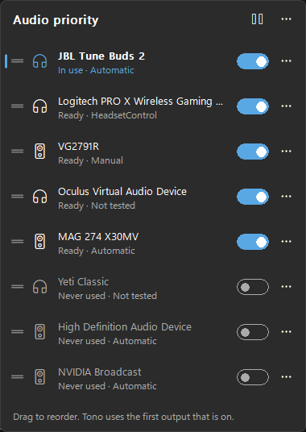

<p align="center"></p>

# 🎧 Tono — Audio Priority
[](https://opensource.org/licenses/MIT)

Put your audio outputs in order and let Windows follow it. 🔊  
Earbuds out of the case? Sound goes there. Headset on? It goes to the headset. Nothing else? The monitor. Tono always picks the first output on your list that is actually on.

Windows only switches when the output in use disappears, and then to whatever it likes. Tono lives in the notification area, does nothing until something connects or disconnects, and never fights you when you pick an output yourself. 🪶

<p align="center"></p>

---

## 🚀 Features

- 📋 **Priority list**: drag your outputs into order; the first one that is on becomes the default
- 🔌 **Follows what Windows sees**: Bluetooth earbuds going into their case, USB headsets unplugged, monitors turned off
- 🎮 **Wireless USB headsets** that stay "connected" while switched off (Logitech, SteelSeries, HyperX, Corsair and many more): Tono can ask them directly through [HeadsetControl](https://github.com/Sapd/HeadsetControl), downloaded only if you want it
- ✋ **Manual mode** for anything that cannot be detected: mark it on or off from the tray menu
- 🧪 **Test each output**: turn it off and on while Tono watches, and it tells you how it can be detected
- 🚫 **Never use an output**: switch it off in the list (handy for virtual devices)
- 🙋 **Your choice wins**: if you, a game or SteamVR pick another output, Tono leaves it until the next device connects or disconnects
- ⏸️ **Pause** from the panel or the tray menu
- 🆕 **New outputs** are added at the end of the list and Tono tells you, so you can put them where you want
- ⏳ Waits a moment before switching, so Bluetooth hiccups and monitors going to sleep do not make it jump around
- 🛡️ When in doubt, it does nothing: if a headset does not answer, the output stays as it is
- 🎤 Bluetooth "Hands-Free" duplicates are hidden; the good-quality stereo output is used
- 🔒 100% offline: nothing leaves your PC. No telemetry, no accounts
- 🌙 Clean Windows 11 look that follows your light or dark theme and accent color
- 🪶 Tiny: ~0 CPU while idle, a ~0.4 MB program, no .NET or Visual C++ runtime needed
- 🚦 Starts with Windows (you can turn it off)

---

## 📦 Install

Download `TonoSetup.exe` from [Releases](https://github.com/VitomDev/Tono-Audio-Priority/releases/latest) and run it.

> 🧰 **Recommended:** install it with [Vitool Box](https://github.com/VitomDev/Vitool-Box), which keeps all VitomDev apps in one place and installs or removes them with a switch.

- Per-user install, no admin rights needed
- Tono starts right away and opens its list, starting with the output you are using now
- It starts with Windows from then on

> 💡 Windows may put new icons in the hidden icons area (`^`). Drag Tono's icon onto the taskbar to always see it.

Uninstalling (Settings → Apps) removes Tono, its startup entry, its settings and HeadsetControl if it was downloaded.

---

## 🖱️ Usage

| Action | How |
| --- | --- |
| Open the list | Left-click the tray icon |
| Change the order | Drag an output up or down |
| Never use an output | Turn off its switch |
| Test an output | `···` next to it → **Test detection…** |
| Choose how it is detected | `···` next to it → Windows / HeadsetControl / manual |
| Mark a manual output on or off | Right-click the tray icon → **… is on** |
| Pause | ⏸️ in the panel, or right-click the tray icon → **Pause switching** |
| Also switch the communications output (calls, Discord) | Right-click the tray icon → **Also switch the communications output** |
| Start with Windows | Right-click the tray icon → **Start with Windows** |
| Exit | Right-click the tray icon → **Exit Tono** |

The tray icon turns grey while Tono is paused, and its tooltip shows the output in use.

### 🧪 Testing an output

Tono asks you to switch the output off, then on again, and watches:

1. **Windows noticed** → *Automatic*. Nothing else needed (most Bluetooth earbuds and plugged-in headsets).
2. **Windows did not notice** (common with wireless USB headsets, whose receiver stays plugged in) → Tono offers to download HeadsetControl, then tests again. If HeadsetControl can tell → *HeadsetControl*.
3. **Nobody noticed** → *Manual*: mark it on or off yourself from the tray menu.

Monitors and virtual devices do not need a test.

### 🎮 About HeadsetControl

[HeadsetControl](https://github.com/Sapd/HeadsetControl) is a free, open-source tool (GPL v3) by Denis Arnst and contributors that talks to many wireless headsets. It is **not** included in Tono. Only when you ask for it, Tono downloads version 4.2.0 from its official GitHub release, checks that the file is the genuine one (SHA-256) and runs it as a separate program every 3 seconds, only while an output on your list needs it. See [THIRD-PARTY-NOTICES.md](THIRD-PARTY-NOTICES.md).

---

## ⚡ Performance

Tono does not poll Windows: it waits for Windows' own audio notifications and wakes up only when an output connects, disconnects or the default changes. The panel only exists while it is open.

Measured on the development PC (Windows 11, panel closed, over 30 s):

| | |
| --- | --- |
| Idle | 0 ms CPU |
| `Tono.exe` | 0.43 MB |

With a headset detected through HeadsetControl, Tono also starts HeadsetControl every 3 seconds (about 0.1 s each).

---

## 🔧 Build

Requirements: Visual Studio 2022 or newer with the C++ x64 tools and Inno Setup 6 (`winget install JRSoftware.InnoSetup`).

```powershell
.\build.ps1
```

It downloads the pinned build tools into `.deps/` (Windows SDK, CMake and Ninja, all verified by hash), builds everything, runs the tests and writes the installer to `dist/TonoSetup.exe`.

`.\build.ps1 -SkipTests` and `.\build.ps1 -SkipInstaller` skip those steps.

---

## 📚 Dependencies

None: Tono only uses Windows' own APIs (Core Audio notifications, `IPolicyConfig` to set the default output, the same one Windows' sound settings use). HeadsetControl is optional and never bundled. 🧘

---

## 🪟 Compatibility

Windows 10 (version 1809 or newer) and Windows 11, 64-bit.

---

## 🧪 Project Status

✅ Stable.  
This project is fully functional as-is and ready to use.
Future updates to improve features or the interface are not ruled out.

---

## 📄 License

[MIT](LICENSE) © VitomDev

---

## 📲 Contact

Feel free to reach out or follow me:

- 🐙 GitHub: [@VitomDev](https://github.com/VitomDev)
- 🐦 Twitter/X: [@VitomDev](https://twitter.com/VitomDev)
- 🎮 Twitch: [@VitomDev](https://www.twitch.tv/VitomDev)
- 💼 LinkedIn: [VitomDev](https://www.linkedin.com/in/víctor-escós-batalla/)
